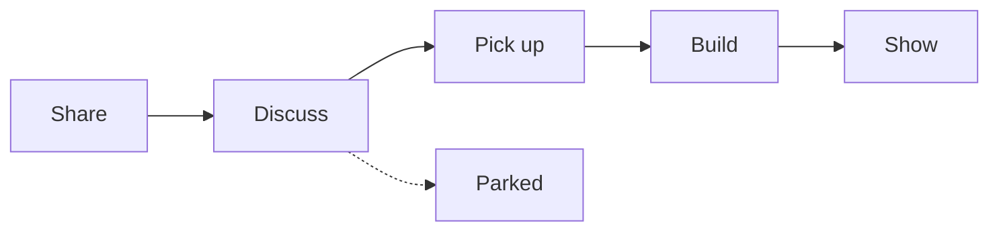

# Idea Lab

**Share project ideas, shape them together, and find people to build them.**

Idea Lab is an open space where anyone can post an idea for a new project (an app, a tool, a library, a browser extension, a game, a hardware hack, anything), get honest feedback, and team up with others to turn the good ones into real things.

[**Share an idea**](https://github.com/dhivadhiva/idea-lab/discussions/new?category=ideas) ·
[**Browse top ideas**](https://github.com/dhivadhiva/idea-lab/discussions/categories/ideas?discussions_q=is%3Aopen+category%3AIdeas+sort%3Atop) ·
[**Show what you built**](https://github.com/dhivadhiva/idea-lab/discussions/new?category=show-and-tell) ·
[**Ask a question**](https://github.com/dhivadhiva/idea-lab/discussions/new?category=q-a)

## How it works

1. **Share.** Start a discussion in **Ideas** and fill in the short form. Describe the problem first, then your idea.
2. **Discuss.** Others upvote it, ask questions, point to tools that already exist, and help find a smaller first version.
3. **Pick up.** Anyone who wants to build it says so in the thread. The idea is labelled `status: in-progress` and a kickoff issue tracks it.
4. **Build.** Build it wherever you like: your own account, an organization, a team repo. Link back to the idea.
5. **Show.** Post the result in **Show and tell** so the people who wanted it can try it.

## Where to post

| Category | Use it for |
| --- | --- |
| **Ideas** | A new project idea, big or small |
| **Q&A** | Questions about an idea, a tech stack, or how to get started |
| **Show and tell** | Something you built, especially from an idea here |
| **Polls** | Asking the community to choose between options |
| **General** | Anything else, including looking for teammates |
| **Announcements** | News from the maintainers |

## Status labels

Every idea carries one status label, so you can see at a glance where it stands.

| Label | Meaning |
| --- | --- |
| `status: new` | Just posted, not reviewed yet |
| `status: discussing` | Gathering feedback and shaping the scope |
| `status: needs-builder` | Well defined and waiting for someone to build it |
| `status: in-progress` | Someone is building it (see the linked kickoff issue) |
| `status: shipped` | Built and released, with a link in the thread |
| `status: parked` | Duplicate, out of scope, or not right now |

Ideas also get `type:` labels (`type: app`, `type: web`, `type: cli`, `type: library`, `type: extension`, `type: ai`, `type: hardware`, `type: game`), and small, beginner-friendly ones get `good first project`.

## What makes a good idea post

- **Start with the problem** and who runs into it. A clear problem gets better feedback than a feature list.
- **Say what exists today** and why it isn't enough.
- **Describe the smallest useful version.** Small first versions are the ones that actually get built.
- **One idea per post.** Search first, and if it's already here, add to that thread instead.

## Want to build something?

Look through [ideas that need a builder](https://github.com/dhivadhiva/idea-lab/discussions?discussions_q=label%3A%22status%3A+needs-builder%22) or [good first projects](https://github.com/dhivadhiva/idea-lab/discussions?discussions_q=label%3A%22good+first+project%22). Comment on the thread to say you're in, then follow [Picking up an idea](CONTRIBUTING.md#picking-up-an-idea).

## Ground rules

- **Ideas posted here are public.** Anyone may build any idea posted here, and posting an idea doesn't make it yours alone. Crediting the person who posted it is always appreciated.
- **Don't post anything confidential**, or anything you plan to patent or keep to yourself.
- **Be kind and constructive.** Critique ideas, not people. Read the [Code of Conduct](CODE_OF_CONDUCT.md).
- **No spam or ads.** Sharing your own project belongs in Show and tell.

More detail on posting, giving feedback and building is in [CONTRIBUTING.md](CONTRIBUTING.md).

---

Maintained by [@dhivadhiva](https://github.com/dhivadhiva).
